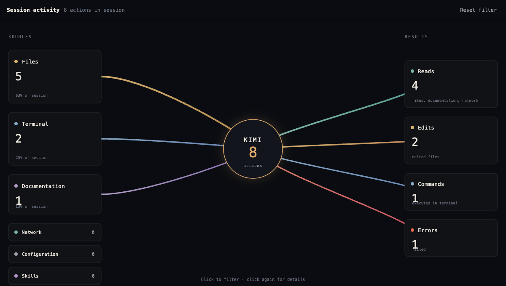
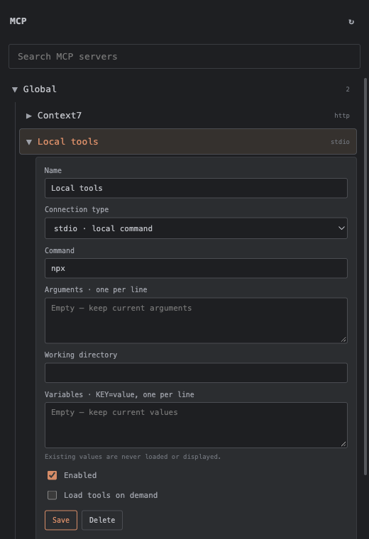

# AI Explorer for OpenIDE

**English** | [Русский](README.ru.md)

AI Explorer embeds the full **Kimi Code CLI** in OpenIDE and provides convenient navigation through sessions, skills, settings, and MCP servers.

The conversation runs in a full PTY terminal rather than a separate chat or a limited CLI emulation. All commands, interactive menus, and Kimi Code features remain available.

## Features

### Full Kimi Code in the IDE

- A full terminal with colored output, interactive menus, and slash commands.
- Runs in the current project root.
- A separate Kimi Code process for each open session.
- Start a new chat, resume the latest session, or open a selected session.
- Use `/sessions`, `/new`, `/compact`, `/model`, `/permission`, and other standard CLI commands.
- Closing a tab terminates its terminal process.

### Chat list

- Sessions are loaded from the local Kimi Code storage.
- Only unarchived sessions from the current project are shown.
- Search, date grouping, refresh, and quick session opening.
- Rename and delete sessions from the side panel.
- Open tab titles update automatically after Kimi generates a session title.
- Renaming does not restart the terminal or lose the current conversation.

### Kimi account sign-in

The **Sign in to Kimi Code** button starts the standard `kimi login` command in a separate terminal tab.

It uses the standard OAuth device-code flow: Kimi displays an authorization link and code. The plugin does not read, transmit, or store tokens itself. The same button can be used to switch accounts.

### Activity graph

The **Show activity graph** button switches the editor between the terminal and a visual map of Kimi's work.

The graph displays:

- project files;
- documentation;
- skills;
- configuration;
- terminal commands;
- network requests;
- subagents.

Additional features:

- flows between action sources and outcomes;
- filtering by source or outcome;
- a central session action counter;
- tables of files and full terminal commands;
- request history with exact timestamps and durations;
- opening files in the IDE or websites in the browser.

The graph reads the current session's local journals and updates as Kimi works.



### Skills navigator

The **Skills** tab next to **Chats** shows skills available on your computer and in the project:

- global and project directories;
- additional directories from `extra_skill_dirs`;
- nested directories and supporting files;
- frontmatter descriptions;
- local Markdown and wiki links between documents.

Search covers names, descriptions, and paths. Files open in the main OpenIDE editor, where they can be read and edited.

### Settings and instructions

The **Settings** tab gathers Kimi Code configuration:

- global `AGENTS.md` and related documents connected by links;
- global `config.toml` and `tui.toml`;
- project and nested `AGENTS.md` and `CLAUDE.md` files;
- project settings from `.kimi-code`.

Project instructions show their relative directory, making it clear which part of the project each file applies to.

### MCP servers

The **MCP** tab shows:

- global and project configurations;
- server names and connection types;
- whether a server is enabled or disabled;
- which project entries override global ones.

Each server expands into an editor directly in the tree. You can change the connection type, command or URL, working directory, environment variables, and startup mode. Creating, renaming, disabling, and deleting servers are supported. Saving preserves the remaining `mcp.json` fields; existing secrets and sensitive URLs are not displayed. **Advanced → JSON** opens the source file for non-standard settings.



### Text and images

- `Cmd+V` pastes ordinary text.
- If the clipboard contains an image, `Cmd+V` sends Kimi the standard `Ctrl+V` command to attach it.
- `Ctrl+V` continues to invoke the standard image attachment flow.
- The plugin does not save images to temporary files itself; Kimi CLI handles this.
- HTTP and HTTPS links in terminal output become clickable and open in the system browser.
- **Add to AI Explorer…** transfers selected code, its path, and line numbers to the current terminal without sending it automatically.

## Language and settings

The interface is available in English and Russian. English is the default.

Select the language in **Settings → Tools → AI Explorer**. It applies to open panels without restarting terminals and is preserved between IDE launches.

## Installation

1. Install and configure [Kimi Code CLI](https://www.kimi.com/code/docs/en/kimi-code-cli/guides/getting-started.html).
2. In OpenIDE, open **Settings → Plugins → Install Plugin from Disk**.
3. Select the AI Explorer ZIP distribution.
4. Restart the IDE and open the **AI Explorer** window.

The JCEF interface requires the bundled **Web Browser (JCEF)** plugin. The terminal requires the bundled **Terminal** plugin.

## Building

Use the Java Runtime bundled with OpenIDE and the Gradle Wrapper included in the repository.

```bash
JAVA_HOME="/Applications/OpenIDE.app/Contents/jbr/Contents/Home" ./gradlew buildPlugin
```

The distribution will appear in `build/distributions/`.

To check compilation without building the ZIP:

```bash
JAVA_HOME="/Applications/OpenIDE.app/Contents/jbr/Contents/Home" ./gradlew compileKotlin
```

## Technical details

- Kotlin and IntelliJ Platform Gradle Plugin.
- JediTermWidget and PtyProcessBuilder for a real PTY.
- JCEF for the side panel, activity graph, and resource navigators.
- Local reading of Kimi Code sessions and configuration.
- Resource refresh after file changes through VFS.
- No ACP or custom conversation protocol.

See [SPEC.md](SPEC.md) for a detailed description of the behavior.

## Current version

**0.7.0**
