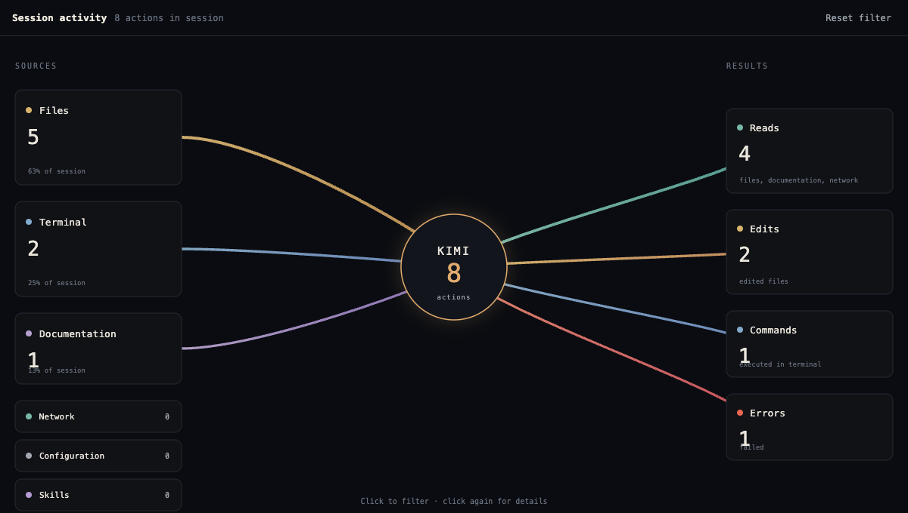
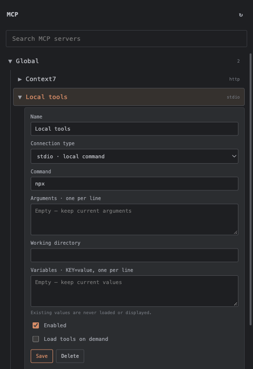

# AI Explorer для OpenIDE

[English](README.md) | **Русский**

Плагин встраивает настоящий **Kimi Code CLI** в OpenIDE и добавляет удобную навигацию по сессиям, скиллам, настройкам и MCP-серверам.

Диалог работает в полноценном PTY-терминале: это не отдельный чат и не ограниченная эмуляция CLI. Все команды, интерактивные меню и возможности Kimi Code остаются доступными.

## Возможности

### Настоящий Kimi Code в IDE

- Полноценный терминал с цветным выводом, интерактивными меню и slash-командами.
- Работа в корне текущего проекта.
- Отдельный процесс Kimi Code для каждой открытой сессии.
- Создание нового чата, продолжение последнего и открытие выбранной сессии.
- Доступны `/sessions`, `/new`, `/compact`, `/model`, `/permission` и остальные штатные команды CLI.
- При закрытии вкладки связанный терминальный процесс завершается.

### Список чатов

- Сессии загружаются из локального хранилища Kimi Code.
- Отображаются только неархивные сессии текущего проекта.
- Поиск, группировка по датам, обновление и быстрое открытие.
- Переименование и удаление сессий из бокового окна.
- Названия открытых вкладок автоматически обновляются после того, как Kimi создаёт заголовок сессии.
- Переименование не перезапускает терминал и не теряет текущий диалог.

### Вход в аккаунт Kimi

Кнопка **«Войти в Kimi Code»** запускает штатный `kimi login` в отдельной терминальной вкладке.

Используется стандартный OAuth device-code flow: Kimi показывает ссылку и код для авторизации. Плагин не читает, не передаёт и не сохраняет токены самостоятельно. Ту же кнопку можно использовать для смены аккаунта.

### Карта активности

Кнопка **«Показать граф активности»** переключает редактор между терминалом и визуальной картой работы Kimi.

На карте отображаются:

- файлы проекта;
- документация;
- скиллы;
- конфигурация;
- терминальные команды;
- обращения к сети;
- субагенты.

Дополнительно доступны:

- ленты между источниками и результатами действий;
- фильтрация по источнику или результату;
- центральный счётчик действий за сессию;
- таблицы файлов и полных терминальных команд;
- история обращений с точным временем и длительностью;
- открытие файла в IDE или сайта в браузере.

Карта читает локальные журналы текущей сессии и обновляется во время работы.



### Навигатор скиллов

Вкладка **Skills** рядом с **Chats** показывает скиллы, доступные на компьютере и в проекте:

- глобальные и проектные каталоги;
- дополнительные каталоги из `extra_skill_dirs`;
- вложенные каталоги и вспомогательные файлы;
- описания из frontmatter;
- локальные Markdown- и wiki-ссылки между документами.

Поиск учитывает названия, описания и пути. Файл открывается в основном редакторе OpenIDE, где его можно читать и изменять.

### Настройки и инструкции

Вкладка **Settings** собирает конфигурацию Kimi Code:

- глобальные `AGENTS.md` и тематические документы, связанные ссылками;
- глобальные `config.toml` и `tui.toml`;
- проектные и вложенные `AGENTS.md`, `CLAUDE.md`;
- проектные настройки из `.kimi-code`.

Для проектных инструкций отображается относительный каталог, поэтому видно, к какой части проекта относится файл.

### MCP-серверы

Вкладка **MCP** показывает:

- глобальные и проектные конфигурации;
- имена серверов и способ подключения;
- включён или выключен сервер;
- какие проектные записи переопределяют глобальные.

Сервер раскрывается в форму прямо в дереве: можно изменить тип подключения, команду или URL, рабочую директорию, переменные окружения и режим запуска. Поддерживаются создание, переименование, отключение и удаление серверов. Сохранение не затирает остальные поля `mcp.json`; существующие секреты и чувствительные URL не отображаются. Кнопка **«Дополнительно → JSON»** открывает исходный файл для нестандартных настроек.



### Работа с текстом и изображениями

- `Cmd+V` вставляет обычный текст.
- Если в буфере обмена изображение, `Cmd+V` передаёт Kimi штатную команду `Ctrl+V` для прикрепления картинки.
- `Ctrl+V` продолжает вызывать стандартное прикрепление изображения.
- Плагин не сохраняет изображения во временные файлы самостоятельно — этим управляет Kimi CLI.
- HTTP и HTTPS ссылки в выводе становятся кликабельными и открываются в системном браузере.
- Действие **«Добавить в AI Explorer…»** переносит выделенный код, путь и строки в текущий терминал без автоматической отправки.

## Язык и настройки

Интерфейс доступен на английском и русском языках. По умолчанию используется английский.

Язык выбирается в **Settings → Tools → AI Explorer** и применяется к открытым панелям без перезапуска терминалов. Настройка сохраняется между запусками IDE.

## Установка

1. Установите и настройте [Kimi Code CLI](https://www.kimi.com/code/docs/en/kimi-code-cli/guides/getting-started.html).
2. В OpenIDE откройте **Settings → Plugins → Install Plugin from Disk**.
3. Выберите ZIP-дистрибутив AI Explorer.
4. Перезапустите IDE и откройте окно **AI Explorer**.

Для JCEF-интерфейсов необходим штатный плагин **Web Browser (JCEF)**. Для терминала — плагин **Terminal**.

## Сборка

Требуется Java Runtime из OpenIDE и Gradle Wrapper, включённый в репозиторий.

```bash
JAVA_HOME="/Applications/OpenIDE.app/Contents/jbr/Contents/Home" ./gradlew buildPlugin
```

Готовый дистрибутив появится в `build/distributions/`.

Для проверки компиляции без сборки ZIP:

```bash
JAVA_HOME="/Applications/OpenIDE.app/Contents/jbr/Contents/Home" ./gradlew compileKotlin
```

## Технические особенности

- Kotlin и IntelliJ Platform Gradle Plugin.
- JediTermWidget и PtyProcessBuilder для настоящего PTY.
- JCEF для бокового интерфейса, карты активности и навигаторов ресурсов.
- Локальное чтение сессий и конфигурации Kimi Code.
- Обновление ресурсов после изменения файлов через VFS.
- Никакого ACP и собственного протокола диалога.

Подробное описание поведения находится в [SPEC.md](SPEC.md).

## Текущая версия

**0.7.0**
